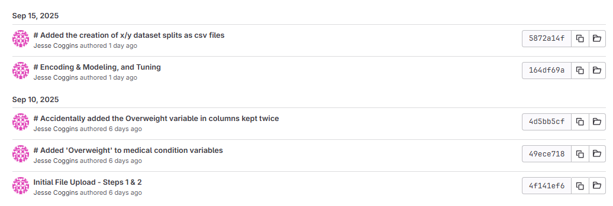
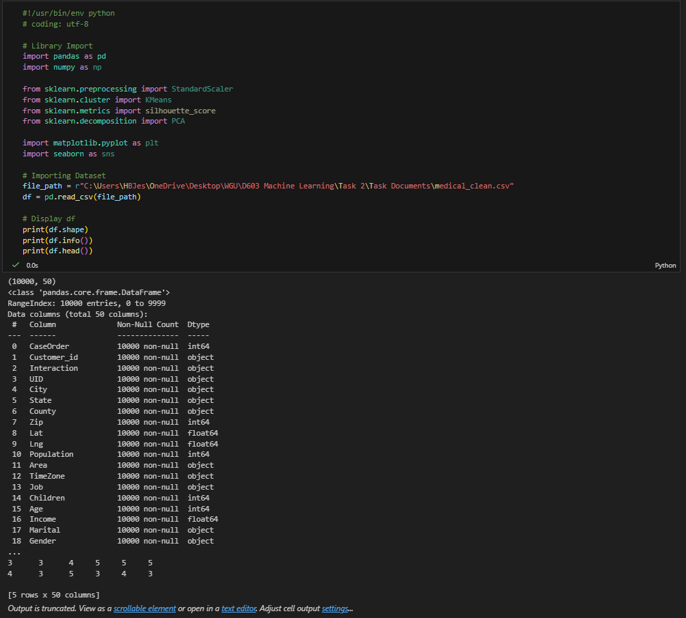

# Hospital Readmission ML

## Overview
This repo combines two machine learning workflows built from the hospital dataset: a supervised classification project and an unsupervised clustering and PCA project. Together, they show breadth across predictive modeling and pattern discovery in healthcare data.

## Academic Context
Completed during my M.S. in Data Analytics at Western Governors University (WGU), then packaged here as a public portfolio project. Screenshots from the original written submissions are preserved in `assets/task1-report-extracts/` and `assets/task2-report-extracts/`.

## What It Shows
- classification modeling for hospital outcome analysis
- data preparation and encoded feature sets
- clustering workflow for segmentation
- PCA-based dimensionality reduction and visualization

## Included Files
- `notebooks/readmission_classification.ipynb`
- `notebooks/readmission_clustering_pca.ipynb`
- `data/medical_clean.csv`
- `requirements.txt`

## Results

- Random Forest classification achieved test accuracy of `0.980`, precision of `0.964`, recall of `0.982`, F1-score of `0.973`, and ROC-AUC of `0.999` after tuning.
- A feature-timing sensitivity check showed that `Initial_days` drives most of the full model's signal. When that post-admission stay-length feature is excluded, ROC-AUC drops to `0.498`, so the classification workflow is best interpreted as discharge-time risk stratification rather than a pre-admission readmission predictor.
- The [published clustering notebook](notebooks/readmission_clustering_pca.ipynb) groups eight survey ratings about patients’ experience of care. It uses K-Means with three clusters and PCA for visualization.
- The [original clinical report images](assets/task2-report-extracts/) cover a separate version of the analysis using age, length of stay, charges and health indicators. The survey notebook does not reproduce those clinical profiles.

## Selected Visuals

